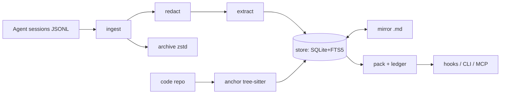

# Architecture

## Overview

A single Rust binary with no daemon. Each command (hook, CLI, or the MCP stdio server) opens the SQLite store, does its work, and exits.

## Components

| Component | Responsibility                                                                                     | Depends on              |
| --------- | -------------------------------------------------------------------------------------------------- | ----------------------- |
| `harness` | Per-agent adapters: locate sessions, parse JSONL into normalized `Event`s, install/uninstall hooks | none                    |
| `ingest`  | Resumable scan → parse → normalize pipeline with checkpoints (file, byte offset)                   | harness, archive, store |
| `archive` | Immutable zstd copies of source sessions, keyed by content hash                                    | none                    |
| `redact`  | Layered secret scrubbing (rules + entropy) on all text before persist                              | none                    |
| `extract` | Rule-based: events → typed atomic memories with confidence and provenance                          | redact                  |
| `anchor`  | tree-sitter symbol resolution + hashing; staleness checks against the working tree                 | store                   |
| `store`   | The only SQLite access: schema, migrations, FTS5, dedup, supersede, ledger                         | none                    |
| `pack`    | Retrieve + rank + fit to a token budget; log to the ledger                                         | store, anchor           |
| `mirror`  | Write and read one markdown file per memory; rebuild the DB from the mirror                        | store                   |
| `mcp`     | stdio MCP server, 4 tools                                                                          | pack, store             |
| `cli`     | Argument parsing and output formatting only                                                        | all                     |

## Boundaries

- Only `store` runs SQL.
- Only `harness` knows agent-specific formats. Everything downstream sees `Event` and `Memory`.
- Text passes `redact` before it reaches `store`, `mirror`, or `archive` metadata. Archive bytes are the original session, kept with the same permissions as the source.
- `main.rs` and `cli` hold no business logic.

## Data flow

1. `recalla backfill`: harness finds sessions → ingest reads from the last checkpoint → archive copies the file → events are redacted → extract produces memories → store dedups (content hash + key) and inserts → mirror writes `.md` → checkpoint is saved.
2. Capture hook (Stop/PreCompact) runs the same pipeline on just the current session, incrementally.
3. SessionStart hook: detect the project (git root + remote) → anchor refreshes staleness for that project's memories → pack builds a pack within budget → stdout to the agent → ledger row.
4. MCP `recall` / `why` / `remember` / `review` work as thin wrappers over pack and store.

## Cross-cutting

- **Errors:** `thiserror` in the lib, `anyhow` at the CLI edge. No silent catches. A hook failure must never block the agent: log it and exit 0 with an empty pack.
- **Logging:** `tracing` to stderr and `~/.local/state/recalla/log`. Never log memory content at info level.
- **Config:** `~/.config/recalla/config.toml`, validated at startup. Env `RECALLA_HOME` overrides the data dir.
- **Auth:** none (local, single user). File permissions are 0600/0700.

## Store schema (v1)
- `memories`: one row per atomic memory.
  - `uid`: blake3 of kind|scope|normalized text (deterministic, idempotent).
  - Scope columns, confidence, importance, status, `superseded_by`, `seen_count`, valid-time interval.
- `provenance`: 1..n per memory. Unique on (memory, harness, session, message, line).
- `anchors`: code locations (path, symbol, lang, content_hash, commit). Unique on (memory, path, symbol).
- `relations`: (src, dst, kind). Currently only `supersedes` (new → old).
- `memories_fts`: FTS5 external-content table over `text` only, synced by triggers. Kind is filtered via SQL, not FTS.
- Migrations: an append-only list + `PRAGMA user_version`, applied in one IMMEDIATE transaction.

## Redaction (`redact`)
- `redact(&str) -> Redacted { text: Cow, findings }`. Clean text is borrowed. Each secret becomes `[REDACTED:<rule>]`. Idempotent.
- Layer 1, known formats: one regex per rule plus a per-rule validator; boundaries are checked in code (CJK- and JSON-escape-safe).
- Layer 2, keyword assignments: redacts only the value.
  - Any key word ending in a secret word counts (`PGPASSWORD`, `apitoken`).
  - Unquoted values run to whitespace; JSON values stop at structure.
  - Code is exempt only when the whole value is a call, path or reference.
  - Placeholders are exempt only as whole values.
  - Values scan at most 4 KB ahead and the scan always moves forward (linear-time).
- Headers: any `Authorization` scheme and `Cookie`/`Set-Cookie` values are redacted; URL passwords run to the last `@`.
- Layer 3, entropy: tokens of 24+ chars with 3+ char classes and entropy ≥ `min(4.0, log2(len)-0.85)`.
  - Excludes hex/UUID/identifiers/camelCase, base64 prose, and exact-shape agent ids (`toolu_…`, `msg_…`).
  - A token containing `/` is skipped only if it is a clear path; otherwise it is judged whole.
- Layers never defer to each other; a residual pass redacts any recognised secret key/header value left uncovered (D-009). Input is expected JSON-decoded by the harness.
- `redact()` reruns detection on its output (≤4 passes) and maps findings back, so idempotence holds by construction (D-010).
- Merge gate: `tests/realistic_corpus.rs`, 108 real-world credential templates.
- Spans merge (earliest start, then longest, then lowest layer). Offsets are byte offsets on char boundaries in the original text.
- Measured on real sessions: 46 MB/s release. Most layer-3 hits are structural blobs (`signature`, `encrypted_content`, base64 images), which harness parsers should drop before redaction.
