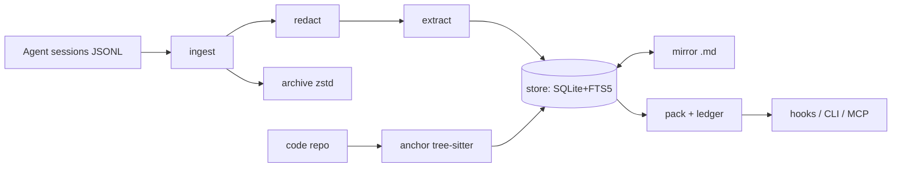

# Architecture

## Overview

A single Rust binary with no daemon. Each command (hook, CLI, or the MCP stdio server) opens the SQLite store, does its work, and exits.

## Components

| Component | Responsibility                                                                                     | Depends on              |
| --------- | -------------------------------------------------------------------------------------------------- | ----------------------- |
| `harness` | Per-agent adapters: locate sessions, parse JSONL into normalized `Event`s, install/uninstall hooks | none                    |
| `ingest`  | Resumable scan → parse → normalize pipeline with checkpoints (file, byte offset)                   | harness, archive, store |
| `archive` | Immutable zstd copies of source sessions, keyed by content hash                                    | none                    |
| `redact`  | Layered secret scrubbing (rules + entropy) on all text before persist                              | none                    |
| `extract` | Rule-based: events → typed atomic memories with confidence and provenance                          | redact                  |
| `anchor`  | tree-sitter symbol resolution + hashing; staleness checks against the working tree                 | store                   |
| `store`   | The only SQLite access: schema, migrations, FTS5, dedup, supersede, ledger                         | none                    |
| `pack`    | Retrieve + rank + fit to a token budget; log to the ledger                                         | store, anchor           |
| `mirror`  | Write and read one markdown file per memory; rebuild the DB from the mirror                        | store                   |
| `mcp`     | stdio MCP server, 4 tools                                                                          | pack, store             |
| `cli`     | Argument parsing and output formatting only                                                        | all                     |

## Boundaries

- Only `store` runs SQL.
- Only `harness` knows agent-specific formats. Everything downstream sees `Event` and `Memory`.
- Text passes `redact` before it reaches `store`, `mirror`, or `archive` metadata. Archive bytes are the original session, kept with the same permissions as the source.
- `main.rs` and `cli` hold no business logic.

## Data flow

1. `recalla backfill`: harness finds sessions → ingest reads from the last checkpoint → archive copies the file → events are redacted → extract produces memories → store dedups (content hash + key) and inserts → mirror writes `.md` → checkpoint is saved.
2. Capture hook (Stop/PreCompact) runs the same pipeline on just the current session, incrementally.
3. SessionStart hook: detect the project (git root + remote) → anchor refreshes staleness for that project's memories → pack builds a pack within budget → stdout to the agent → ledger row.
4. MCP `recall` / `why` / `remember` / `review` work as thin wrappers over pack and store.

## Cross-cutting

- **Errors:** `thiserror` in the lib, `anyhow` at the CLI edge. No silent catches. A hook failure must never block the agent: log it and exit 0 with an empty pack.
- **Logging:** `tracing` to stderr and `~/.local/state/recalla/log`. Never log memory content at info level.
- **Config:** `~/.config/recalla/config.toml`, validated at startup. Env `RECALLA_HOME` overrides the data dir.
- **Auth:** none (local, single user). File permissions are 0600/0700.
