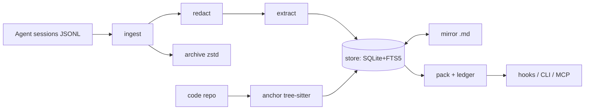

# Architecture

## Overview

A single Rust binary with no daemon. Each command (hook, CLI, or the MCP stdio server) opens the SQLite store, does its work, and exits.



## Components

| Component | Responsibility                                                                                     | Depends on              |
| --------- | -------------------------------------------------------------------------------------------------- | ----------------------- |
| `harness` | Per-agent adapters: locate sessions, parse JSONL into normalized `Event`s, install/uninstall hooks | none                    |
| `ingest`  | Resumable scan → parse → normalize pipeline with checkpoints (file, byte offset)                   | harness, archive, store |
| `archive` | Immutable zstd copies of source sessions, keyed by content hash                                    | none                    |
| `redact`  | Layered secret scrubbing (rules + entropy) on all text before persist                              | none                    |
| `extract` | Rule-based: events → typed atomic memories with confidence and provenance                          | redact                  |
| `anchor`  | tree-sitter symbol resolution + hashing; staleness checks against the working tree                 | store                   |
| `store`   | The only SQLite access: schema, migrations, FTS5, dedup, supersede, ledger                         | none                    |
| `pack`    | Retrieve + rank + fit to a token budget; log to the ledger                                         | store, anchor           |
| `mirror`  | Write and read one markdown file per memory; rebuild the DB from the mirror                        | store                   |
| `mcp`     | stdio MCP server, 4 tools                                                                          | pack, store             |
| `cli`     | Argument parsing and output formatting only                                                        | all                     |

## Boundaries

- Only `store` runs SQL.
- Only `harness` knows agent-specific formats. Everything downstream sees `Event` and `Memory`.
- Text passes `redact` before it reaches `store`, `mirror`, or `archive` metadata. Archive bytes are the original session, kept with the same permissions as the source.
- `main.rs` and `cli` hold no business logic.

## Data flow

1. `recalla backfill`: harness finds sessions → ingest reads from the last checkpoint → archive copies the file → events are redacted → extract produces memories → store dedups (content hash + key) and inserts → mirror writes `.md` → checkpoint is saved.
2. Capture hook (Stop/PreCompact) runs the same pipeline on just the current session, incrementally.
3. SessionStart hook: detect the project (git root + remote) → anchor refreshes staleness for that project's memories → pack builds a pack within budget → stdout to the agent → ledger row.
4. MCP `recall` / `why` / `remember` / `review` work as thin wrappers over pack and store.

## Cross-cutting

- **Errors:** `thiserror` in the lib, `anyhow` at the CLI edge. No silent catches. A hook failure must never block the agent: log it and exit 0 with an empty pack.
- **Logging:** `tracing` to stderr and `~/.local/state/recalla/log`. Never log memory content at info level.
- **Config:** `~/.config/recalla/config.toml`, validated at startup. Env `RECALLA_HOME` overrides the data dir.
- **Auth:** none (local, single user). File permissions are 0600/0700.

## Store schema (v1)
- `memories`: one row per atomic memory.
  - `uid`: blake3 of kind|scope|normalized text (deterministic, idempotent).
  - Scope columns, confidence, importance, status, `superseded_by`, `seen_count`, valid-time interval.
- `provenance`: 1..n per memory. Unique on (memory, harness, session, message, line).
- `anchors`: code locations (path, symbol, lang, content_hash, commit). Unique on (memory, path, symbol).
- `relations`: (src, dst, kind). Currently only `supersedes` (new → old).
- `memories_fts`: FTS5 external-content table over `text` only, synced by triggers. Kind is filtered via SQL, not FTS.
- Migrations: an append-only list + `PRAGMA user_version`, applied in one IMMEDIATE transaction.

## Redaction (`redact`)
- `redact(&str) -> Redacted { text: Cow, findings }`. Clean text is borrowed. Each secret becomes `[REDACTED:<rule>]`. Idempotent.
- Layer 1, known formats: one regex per rule plus a per-rule validator; boundaries are checked in code (CJK- and JSON-escape-safe).
- Layer 2, keyword assignments: redacts only the value.
  - Any key word ending in a secret word counts (`PGPASSWORD`, `apitoken`).
  - Unquoted values run to whitespace; JSON values stop at structure.
  - Code is exempt only when the whole value is a call, path or reference.
  - Placeholders are exempt only as whole values.
  - Values scan at most 4 KB ahead and the scan always moves forward (linear-time).
- Headers: any `Authorization` scheme and `Cookie`/`Set-Cookie` values are redacted; URL passwords run to the last `@`.
- Layer 3, entropy: tokens of 24+ chars with 3+ char classes and entropy ≥ `min(4.0, log2(len)-0.85)`.
  - Excludes hex/UUID/identifiers/camelCase, base64 prose, and exact-shape agent ids (`toolu_…`, `msg_…`).
  - A token containing `/` is skipped only if it is a clear path; otherwise it is judged whole.
- Layers never defer to each other; a residual pass redacts any recognised secret key/header value left uncovered (D-009). Input is expected JSON-decoded by the harness.
- `redact()` reruns detection on its output (≤4 passes) and maps findings back, so idempotence holds by construction (D-010).
- Merge gate: `tests/realistic_corpus.rs`, 108 real-world credential templates.
- Spans merge (earliest start, then longest, then lowest layer). Offsets are byte offsets on char boundaries in the original text.
- Measured on real sessions: 46 MB/s release. Most layer-3 hits are structural blobs (`signature`, `encrypted_content`, base64 images), which harness parsers should drop before redaction.

## Harness: Claude Code (`harness::claude`)
- Root: `$CLAUDE_CONFIG_DIR` or `~/.claude`.
- Discovery: `projects/*/*.jsonl` plus `projects/*/*/subagents/*.jsonl`. Symlinks are skipped at every level, including symlinked directories such as `subagents/`.
- `parse_session(path, from_offset)` returns `(events, stats, next_offset)`. It reads line by line, never consumes a partial last line, and keeps line numbers absolute on resume.
- Kept: user text, assistant text, tool calls (compact JSON input), tool results, compaction summaries.
- Dropped and counted in `ParseStats`: thinking, images, telemetry/UI record types, `isMeta` records, and `<system-reminder>`/command-wrapper spans.
- Event text is emitted whole. Ingest redacts FIRST, then truncates to 32 KB (`truncate_middle`), so a cut can never split a secret.
- Output is decoded text. It is NOT redacted; ingest must redact every event's text, including tool-call JSON.
- Measured on real logs: 258 MB/s, 0 malformed lines across 26 files.

## Ingest (`ingest`, `recalla backfill`)
- Data dir: `--data-dir`, else `$RECALLA_HOME`, else `$XDG_DATA_HOME/recalla`, else `~/.local/share/recalla`. Dirs are 0700; the DB and its WAL/SHM are 0600.
- Per file:
  1. Identity check decides new / resume / restart / unchanged. It uses blake3 of the ingested prefix (≤4 KB) plus a hash of the last ingested line, and the checkpoint must sit on a `\n`. The root is canonicalized so one file has exactly one source.
  2. Read `[offset, len)` once; parse (`parse_bytes`) and archive from that same buffer.
  3. Per event: `redact` text, tool name, cwd and branch, then `truncate_middle`. ToolCall JSON is redacted per string leaf and then as a whole, and truncated leaf-first so it stays valid (D-015).
  4. zstd segment of the raw bytes `[offset, next_offset)`.
  5. One IMMEDIATE txn: optional reset + events + checkpoint + segment row.
- Re-runs are idempotent: `UNIQUE(source_id, line, seq)`. One line can emit several events.
- Archive: `archive/<blake3>.zst`, content-addressed, written once (tmp + fsync + rename). Holds RAW bytes (local copy, 0600). `--no-archive` opts out.
- Measured on real logs: 30.4 MB in 0.65 s (28 MB peak RSS). DB ~20% of raw; archive ~16% of raw. Re-run is a no-op in 1 ms.

### Scoped backfill (`select`)

`backfill --dir/--session` filters the discovered files before anything is opened. `select` matches a session's working directory (read from the first records, since Claude's project folder name is a lossy encoding) by path prefix on canonical paths, or its id (exact, or 8+ characters of start/end; subagent files follow their parent session). Selectors that match nothing fail the run before the store is touched. `--list` prints candidates; `--pick` is a stdin menu (tool, then sessions) that resolves to id selectors. Sources are keyed by path, so partial runs compose with later full ones.

## Store schema (v2)
- `sources`: one checkpoint per log file (identity, size, next_offset).
- `events`: redacted, truncated events with full provenance, plus `events_fts` (FTS5).
- `segments`: archive pieces per source.
- Provenance uniqueness now includes `source_path`.

## Extractor (`extract`, `recalla extract`)
- Reads redacted `events` incrementally from the `extract_state` checkpoint (written after each 1000-event batch). Never reads raw logs or the archive.
- Each event gets a context window of up to 8 earlier events in the same session; project keys are cached per cwd.
- Rules are pure functions over `EventCtx`. Each one returns typed `Candidate`s, which pass through `Store::insert` (uid dedup bumps `seen_count`):
  - **preference:** human user text with directive markers.
  - **decision:** decision phrases, or `## D-NNN` blocks written to DESIGN_DECISIONS.md.
  - **gotcha:** a cause explanation after a tool error in the current exchange.
  - **procedure:** a successful build/test/lint command, normalized to its core (`cd X && make check | tail` becomes `make check`).
  - **fact:** narrow `X is on <version/path>` shapes.
  - **task:** TodoWrite / TaskCreate items; completed items get archived.
- Subagent (sidechain) "user" text is the orchestrator's instructions, not the human's, so it never yields preferences, facts or user decisions.
- Questions are skipped, including ones without a `?`.
- `EXTRACTOR_VERSION` bump or `--rebuild`: archive backfill-only memories, then re-extract.
- Eval gate: `tests/extract_eval.rs` over 11 synthetic sessions / 52 labels requires zero false positives. Real-data review is a standing step, because an eval written alongside the rules overfits.
- Measured: 2,751 real events extracted in 26 ms.

## Context packs (`pack`, `recalla pack|stats|why`)
- Candidates: active + needs_reverify memories in Global ∪ Project(key) ∪ Module(key), where key = `project_key(cwd)` (git toplevel).
- Score = kind weight × confidence × (1 + ln seen_count) × recency (90-day half-life floor 0.5). `--query` multiplies BM25 hits by 1.5 + normalized rank. Ties break on uid.
- Greedy fill in rank order with per-section caps (procedures ≤6 …); fixed section order: Preferences, Gotchas, Decisions, Procedures, Tasks, Facts, Needs re-verify ⚠.
- Budget enforced on `est_tokens = ceil(bytes/3) + 2/line`, which overestimates real tokens (D-016). A property test covers 500 random sets.
- Ledger: `injections` table (schema v4), one row per non-empty pack with via cli|hook|mcp. `stats` reports totals, per project and most-injected memories.
- `why <uid-prefix>`: memory, provenance and the stored (redacted) source event text.
- Preferences are project-scoped unless explicitly global ("in all projects", "everywhere"), so one repo's rules never leak into another's pack.

## Agent integration (`mcp`, `hook`, `hooks_cfg`)
- **MCP:** `recalla mcp` is a hand-rolled sync JSON-RPC over stdio (D-017), one message per line, with protocol-only stdout.
  - Speaks both 2026-07-28 (`server/discover`, `_meta` protocolVersion, `resultType`) and legacy `initialize`.
  - 4 tools, `tools/list` ≈430 tokens:
    - `recall`: a pack, logged with via=mcp
    - `remember`: redacted, Origin::Remember, always project-scoped (an agent can't plant memories in other projects)
    - `review`: confirm, or a reversible forget
    - `why`
  - The store is opened lazily per call.
  - `review` and `why` only reach this project's memories plus Global ones. Global memories are read-only over MCP (CLI only), and their `why` hides source files and excerpts.
- **Hooks** (Claude Code) never block, never write to stdout except the pack, and always exit 0. Errors go to `<data>/log/hook.log` (0600, rotated at 1 MB) (D-018).
  - `hook session-start`: first catches up the project's recent transcripts (D-027), then emits the pack for `project_key(cwd)` as `hookSpecificOutput.additionalContext`.
  - `hook capture` (Stop, PreCompact): ingests ONLY `transcript_path`, and only if it sits under `<claude root>/projects`, then extracts. The source key matches backfill's, so there are no duplicates.
  - Hook connections use a 2 s busy timeout.
  - `hook pre-tool-use` (opt-in via `hooks install --file-recall`): for Read/Edit/Write/MultiEdit it looks up active memories with a non-stale anchor on the file (project-relative path), skips uids already injected in that session (the `injections` ledger is the dedupe), injects at most 5 items / 300 tokens as `additionalContext` (no `permissionDecision`), and records an injection.
  - Measured: session-start ≈1 ms; capture 0.13 s for a 7.4 MB first run, 0.02 s incrementally.
- **`hooks install|uninstall|status`** edits `~/.claude/settings.json`:
  - refuses malformed JSON
  - timestamped backup, atomic write, mode preserved, symlinks followed
  - key order preserved (`serde_json/preserve_order`)
  - touches only entries whose command is exactly `<…/recalla> hook <sub>`; customized or merely-mentioning entries are left alone
  - backups are `create_new` (never overwritten), 0600
  - prints the MCP registration commands for Claude Code and Codex without running them

## Doctor (`doctor`, `recalla doctor`)
- Read-only health check, `Inputs` (paths, `PATH`, clock) injected so tests are hermetic. Checks, in order: binary on `PATH` (same file as the running exe), Claude hooks, Claude MCP (`.claude.json`, user or project scope), Codex MCP (`config.toml`, including the per-tool `recall` approval), database schema, data-dir mode, last capture, last injection, mirror dirty count, hook log tail.
- Levels: ok, warn, fail, skip (tool not installed / no database). Exit 1 only on fail; `--json` for scripts. Each non-ok check carries a `fix`.
- It never creates files (a read-only open of the WAL database may create `-shm`/`-wal` sidecars). The hook log only records errors, so "did it fire?" is answered from timestamps in the database.

## Code anchors (`anchor`, `recalla check|confirm`)
- **Anchoring at extraction**, for Project/Module memories whose key is an existing dir:
  - Candidate identifiers come from the memory text (backticked spans, CamelCase, snake_case).
  - They are matched against tree-sitter definitions (Rust, Python, Go, TS/TSX, JS; each a cargo feature) in two sets of files:
    - files named in the text, which can fall back to a path-only anchor;
    - files read or edited in the same session window, symbol-only and never path-only.
  - Anchor = path relative to the project root + qualified symbol + whitespace-normalized blake3 of the definition + git HEAD.
  - Every path must canonicalize under the project root.
- **Staleness** (`anchor::check`):
  - A symbol changed, a symbol removed, or a file removed sets the memory to `needs_reverify`, with the reason stored on the anchor (schema v5).
  - Edits to other symbols in the same file, and pure reformatting, change nothing.
  - Path-only anchors go stale only when the file is deleted.
  - It runs:
    - with a 50 ms budget inside every pack (CLI, SessionStart hook, MCP `recall`)
    - with 200 ms after hook capture
    - in full via `recalla check`
- **MCP `remember`** anchors a new memory exactly as extraction does (paths named in the text, project-scoped, root must be a real project dir), so agent-saved memories go stale too.
- **Forget** (`recalla forget <id>`): archive by uid prefix (≥4 hex; ambiguous lists candidates, exit 2; unknown exit 1), sync the mirror. Allowed for Global memories (human path). Undo with confirm.
- **Confirm** (`recalla confirm`, MCP `review confirm`): re-resolve the anchors, clear the reasons, set the memory Active. Symbol anchors stay symbol-only.
- **Pack:** the "Needs re-verify ⚠" lines show the reason, e.g. `(symbol changed: Store::insert)`.
- **Redaction:** `cwd` and `git_branch` use `redact_path` (layers 1–2, no entropy), so random path components don't break project keys (D-020).
- **Binary size:** 4.8 MB → 10.1 MB with all grammars, 4.8 MB with `--no-default-features` (D-019).

## Harness: Codex (`harness::codex`)
- Root: `$CODEX_HOME` or `~/.codex`. Discovery walks `sessions/**/rollout-*.jsonl`, skipping symlinks at every level.
- Mapping (same `Event` contract as Claude):
  - user/assistant `response_item` messages: injected `<environment_context>`/`<user_instructions>` stripped; developer role skipped
  - `CommandExecution` → Bash ToolCall + ToolResult (`is_error` from `exit_code`)
  - `FileChange` → one Edit ToolCall per path (feeds anchor windows)
  - `compacted` → Summary
- A resume replays only the `session_meta`/`turn_context` lines of the prefix, to recover the session id and cwd.
- `backfill --harness claude|codex|all` (default all). Each source row records its harness; extraction and packs are harness-agnostic, so one memory carries provenance from both agents.
- Measured: 11.4 MB in 0.12 s, 451 events.

## Mirror (`mirror`, `recalla mirror|rebuild`)

- Location: `<data>/mirror/global/<kind>/<uid>.md` and `<data>/mirror/projects/<slug>/<kind>/<uid>.md`. `<slug>` = sanitized project basename (`[a-z0-9-]`, max 40) + `-` + first 6 hex of blake3(project key). Names come only from kind, hex uid and slug, never from content. Dirs 0700, files 0600.
- One file per memory, in every status: archived and superseded memories keep theirs (status is in the frontmatter). Files are never deleted; files whose uid is not in the DB are reported as strays on `recalla mirror --full`.
- Format (`format: 1`, own YAML subset, ADR D-021). Scalars are bare when they match `[A-Za-z0-9_./:@+-]+` and can't read as another type, else JSON-quoted. The frontmatter ends at the first `---` line; the text follows verbatim with one trailing newline.

```
---
format: 1
uid: 5f0c1d2e3a4b5c6d7e8f9a0b1c2d3e4f
kind: decision
scope: module                 # global | project | module
project: /work/recalla        # project and module scope
module: src/store             # module scope only
status: needs_reverify        # active | needs_reverify | superseded | archived
confidence: 0.85
importance: 2
seen_count: 3
created_at: 2025-01-02T03:04:05.678Z
updated_at: 2025-01-02T03:04:06.000Z
valid_from: 2025-01-02T03:04:05.678Z
valid_to: ...                 # optional
superseded_by: <uid>          # optional
provenance:                   # `provenance: []` when empty
  - origin: backfill
    recorded_at: 2025-01-02T03:04:05.678Z
    harness: claude-code
    session_id: "s 1"
    line: 42
anchors:                      # `anchors: []` when empty
  - path: src/store/mod.rs
    symbol: Store::open
    lang: rust
    stale_reason: "symbol changed: Store::open"
---
Use WAL.
```

- Sync (`mirror::sync(store, dir, full)`): renders the memories in the `mirror_dirty` set (all when `full`), compares bytes with the file on disk, writes only the differing ones (tmp + rename; fsync only for small batches), then clears exactly the marks it read. No clock is involved, so clock skew cannot freeze it, and a change made mid-sync gets a newer mark and is picked up next time. Runs best effort after `backfill`/`extract` (skip with `--no-mirror`), `hook capture`, MCP `remember`/`review`, and CLI `confirm`/`check`; a failure is a warning (stderr, or the hook log), never fatal.
- Rebuild (`mirror::rebuild(data_dir, mirror, apply, allow_drop)`): parse and verify all files first (uid matches `model::uid`, no duplicates, `superseded_by` resolves, value ranges, and every string must be stable under `redact`/`redact_path` and free of control and invisible characters). Any problem refuses the whole rebuild and lists up to 20 files (messages never echo file content). The dry run reports totals, global count, top projects and memories that would be dropped; `--yes` is refused when the mirror has fewer memories than the DB unless `--allow-drop`. Applying: `VACUUM INTO recalla.db.bak-<unix-secs>[-n]` (pre-created 0600, never overwritten), then `Store::replace_memory_layer` on the LIVE database in one `BEGIN IMMEDIATE` transaction. The DB file is never copied over or renamed, so rebuild is safe while Claude Code hooks or `recalla mcp` have it open. Events, sources, segments, extract state and the injection ledger are untouched.
- Store: schema v7 adds `mirror_dirty(seq, memory_id UNIQUE)`, maintained by triggers on memories, anchors and provenance (seeded with every memory on migration). `Store::mirror_batch`, `clear_mirror_marks`, `memory_uids`, `memories_not_in`, `backup_into`, `replace_memory_layer` (store/mirror.rs).
- Output hygiene: `why`, `stats`, packs and MCP print log-derived fields through `pack::one_line`, which drops control and invisible format characters (bidi, zero-width, tag block, variation selectors).

## Performance
- Run: `make perf` (`tests/perf.rs`, ignored tests, release build). Seeded synthetic data, regenerated each run in a tempdir.
- Machine: Apple M2 (arm64), macOS, NVMe SSD.
- Targets: SPEC invariants (hook <100 ms p95 on 100k memories; 300 MB backfill <5 min).

| Test | Corpus | Result | Target |
|---|---|---|---|
| `backfill_300mb` | 319.5 MB, 601 files (~80% Claude / ~20% Codex), 158k events, archive on | ingest 14.5 s + extract 7.0 s = 21.5 s (14.9 MB/s), 9.7k memories, 2.4k redactions | <300 s |
| no-op rerun | same corpus | 0.03 s | <5 s |
| `hook_session_start_p95`, in-process | 100k memories, 50 projects, ~3k visible, ~200 anchors | p50 11.4 ms, p95 11.7 ms, p99 12.0 ms | p95 <100 ms |
| `hook_pre_tool_use_p95`, in-process | same, 400 calls over 40 anchored files, new session each | p50 1.2 ms, p95 1.4 ms, p99 1.6 ms | p95 <100 ms |
| session-start, spawned binary | same | p50 15.6 ms, p95 18.0 ms, p99 21.0 ms (first exec ~210 ms, one-off OS cost) | |
| `mcp_recall_p95`, no query | same | p50 11.3 ms, p95 11.7 ms | |
| `mcp_recall_p95`, FTS query | same | p50 32.8 ms, p95 40.2 ms | |
| `dashboard_queries_p95` | same + 700 sessions, 20k events, 2k injections | `ui_memories` first page p95 0.7 ms, filtered 2.4 ms, FTS 16 ms; `ui_sessions` 12 ms; `ui_overview` 48 ms; `ui_injections` <1 ms | p95 <100 ms |

- Fix from the first run: `memories_for_project` and `anchors_for_project` scanned the whole `memories` table. Migration v6 adds `memories(scope_project, status)`. Session-start p95 28.7 ms to 11.7 ms.
- Peak RSS is reported on Linux only (`/proc/self/status`); no new dependency for macOS.
- Corpus: user directives, assistant prose with decision/gotcha phrases, build/test Bash calls (15% failing, 5% with 5-50 KB logs), Read/Edit calls, base64 blobs, multibyte text, runtime-built fake secrets.

## Dashboard server (`ui`)

`recalla ui` runs a short-lived local HTTP server (std::net + httparse, ADR D-022): `ui/server.rs` (bounded HTTP core), `ui/security.rs` (pure checks), `ui/assets.rs` (embedded files, fixed table), `ui/router.rs` (`/api` route table), `ui/mod.rs` (`UiHandler`). New routes: add a `Route { method, pattern, handler }` to `default_routes()` in `ui/mod.rs`.

Security model:
- Binds 127.0.0.1 only; random port by default. 32 concurrent connections, 5 s deadline to read a whole request, 30 s total deadline to write a response (single `write` calls with the socket timeout recomputed from the time left, so a client reading slowly is cut off), 16 KiB head, 64 KiB body, one request per connection.
- Two secrets per run, both 256-bit from OS randomness. The session token is private to the process: never printed, never in argv or a URL, only in the `recalla_<port>` cookie (HttpOnly, SameSite=Lax, Path=/ (Lax, not Strict: the login redirect page is a `file://` origin, and a Strict cookie is withheld from a redirect chain that starts there, see D-024); no `Secure`, because Safari rejects it on http). The name carries the port, so a cookie from another run is never accepted. The session also ends server-side after 12 h without an authenticated request (`ServeOptions::session_idle`): everything then answers 401 and the page shows "Session ended". Login uses a separate one-time code: `recalla ui` prints `http://127.0.0.1:<port>/?c=<code>` and, unless `--no-open`, opens a private redirect page instead of that URL: `<data dir>/run/login-<random>.html` (dir 0700, refused when group/world accessible; file 0600; a `<meta refresh>` plus a link to the URL; `file://` pages are outside our CSP). The opener's argv holds only the file path, never the code. The file is deleted when the code is redeemed or expires (watcher thread), when the server stops, and stale `login-*.html` are swept at startup (a SIGINT kill leaves it at most 60 s, until the next start). The code works once and for 60 s (`LOGIN_TTL`), consumed atomically under a mutex. `GET /?c=<code>` sets the cookie and answers 302 to `/`; a wrong, used or expired code is the same 401. `/`, `/assets/*` and `/api/*` need the cookie (no Bearer, no `?t=`). Compared in constant time.
- `Host` must be `127.0.0.1:<port>` or `localhost:<port>` (DNS rebinding). No CORS headers; `OPTIONS` is 405.
- POST also needs `Origin` equal to the server origin and `X-Recalla-Csrf` equal to the per-run value from `GET /api/session`.
- Targets: origin-form only; `..`, empty segments, encoded `/` `\` NUL, control and non-ASCII bytes are 400. Assets come from a fixed table, never the filesystem.
- Every response: strict CSP, nosniff, no-referrer, frame deny, CORP same-origin, no-store. Handler panics become a bare 500.
- Known limits: the one-time code is in stdout (and the 0600 page) for at most 60 s and one use; no TLS (loopback only). Residual: cookies are shared across ports of the same host name, so another local web server on 127.0.0.1 can receive the session cookie (it cannot know the CSRF value or use it from a page on another origin, but it can replay the cookie). Keep the dashboard closed when not in use; `recalla ui --help` says so too.

## Dashboard data layer (`store/ui.rs`)

All dashboard SQL lives in `store/ui.rs` (`impl Store`, read-only, parameterized; `ORDER BY` columns come from the closed `MemorySort` enum). Lists use keyset pagination with an opaque `Cursor` (`Page { rows, next }`); `limit` is clamped to 1..=200. Every log-derived string goes through `ui::security::sanitize` (or `sanitize_multiline` for event text, memory full text and pack text). Project and scope paths are returned in full as stored (e.g. `/work/proj`); `data_dir`, `mirror_dir` and `settings_path` are shown in full with the home directory as `~`. Only source file names (`sources`, `first_source.file`, provenance `file`) are basenames; anchors keep their repo-relative path.

- Schema v8: `injections` gains nullable `session_id`, `pack_text` (exact pack markdown), `candidate_count`, `candidate_tokens` (tokens had every candidate been injected). Rows from before v8 keep NULLs. Recorded by hook `session-start` (has the session id), CLI `pack` and MCP recall. Indexes: `injections(session_id)`, `provenance(session_id, harness)`, and `memories(<col> DESC, id)` for the updated/created/seen/confidence sorts (the keyset `ORDER BY col DESC, id` is then index-ordered; without them a sort over many equal values scanned and sorted the whole table).
- Session: a distinct `(harness, session_id)` in `events`. Project is the cwd of its earliest event; `memory_count` counts distinct memories whose provenance names the pair; `injection_count` counts injections with that `session_id`.
- `saved_pct = (1 - est_tokens / candidate_tokens) * 100` when `candidate_tokens > 0`, otherwise `None` (est 100 vs candidates 400 gives 75).
- Memory list: default statuses are `active` and `needs_reverify`; `q` reuses the FTS query builder of `search`. Memory detail resolves a unique uid prefix and finds injections through `json_each(memory_uids)` (newest 20).

## Dashboard API (`ui/api.rs`, `ui/actions.rs`)

Contract for the frontend. All responses are `application/json; charset=utf-8` with `Cache-Control: no-store`; every string is already sanitized (no control or invisible characters; `\n` and `\t` survive only in fields named `text_full`, `pack_text`, event `text`, `markdown`). Render with `textContent`. Timestamps are unix milliseconds (integers). Auth: the `recalla_<port>` cookie (see the security model above); POSTs also send `Origin` (the page does this by itself) and `X-Recalla-Csrf: <csrf from GET /api/session>`.

Errors are `{"error": "<short generic text>"}`: 400 invalid input (bad limit, cursor, enum, over-long or control-character value), 401 not logged in, 403 Host/Origin/CSRF refused, 404 unknown id or route, 405 wrong method, 409 conflict (ambiguous id prefix, running sync, unusable settings file), 503 database busy or `database needs upgrading`, 500 `internal error` (details only on the server's stderr). Requests the HTTP core itself rejects (bad target, oversize) answer 4xx in plain text.

Conventions: `Page` = `{"items": [...], "next": "<cursor>" | null}`; pass `next` back as `cursor`, unchanged, until it is `null` (`limit` 1..200, default 50, clamped; non-numeric is 400). Filters: `q` at most 200 chars, other string filters at most 500, no control characters; an empty value means "no filter". Path parameters are percent-decoded, at most 500 chars. `*_at`/`*_ts` and counts are numbers; `null` means unknown or not applicable. `confidence` has two decimals; `saved_pct` has one decimal and can be negative (the pack was larger than the baseline).

| Endpoint | Query | Returns |
|---|---|---|
| `GET /api/session` | | `{csrf, version}` |
| `GET /api/overview` | | counts, injection totals, sizes, paths |
| `GET /api/projects` | | `{items: [{project, memory_count}]}`: distinct projects owning active or needs-reverify memories, most first, at most 200 (for the test-recall picker) |
| `GET /api/sessions` | `harness project q cursor limit` | Page of Session |
| `GET /api/sessions/{harness}/{session_id}` | | `{session, memories[MemoryBrief], injections[InjectionBrief]}`; 404 if unknown |
| `GET /api/sessions/{harness}/{session_id}/events` | `after limit` | Page of Event in id order; `after` is a non-negative id, `next` is the last id (string) |
| `GET /api/events/{id}/text` | | `{id, text}` full stored text; 400 non-numeric id, 404 unknown |
| `GET /api/memories` | `kind status project harness q sort cursor limit` | Page of Memory. `kind`/`status` are comma lists of enum names (kinds `decision fact procedure gotcha preference task`; statuses `active needs_reverify superseded archived`; unknown value is 400); default statuses `active,needs_reverify`; `sort` is `updated` (default) `confidence` `seen` `created`, always descending |
| `GET /api/memories/{uid}` | | MemoryDetail; `uid` is a full id or a unique prefix of 4+ hex chars; 404 unknown or too short, 409 ambiguous |
| `GET /api/injections` | `project via session cursor limit` | Page of Injection, newest first |
| `GET /api/injections/{id}` | | InjectionDetail |
| `GET /api/connect` | | Connect status |
| `POST /api/hooks/install`, `POST /api/hooks/uninstall` | | `{changed, changes[string], backup: string \| null, hooks[{event, installed}]}`; 409 when settings.json is not a JSON object or has the wrong shape (file untouched) |
| `POST /api/memories/{uid}/confirm`, `/forget`, `/restore` | | the updated Memory row; confirm re-anchors and reactivates, forget archives, restore sets active; Global memories allowed; 409 ambiguous, 404 unknown, 400 prefix shorter than 4 hex |
| `POST /api/test-recall` | JSON body `{project?, query?, budget?}` | TestRecall; body at most 4 KiB; budget clamped 100..8000 (default 1500); read-only: no injection is logged and the anchor staleness check (which writes) is skipped, so memories show the freshness last stored by `recalla pack`/`check`; works on a read-only connection |
| `POST /api/sync` | | 202 `{job}`; 409 `{error: "sync already running", job}` while one runs |
| `GET /api/sync/status` | | SyncStatus |

**Session**: `{harness, session_id, project: string|null, first_ts, last_ts, event_count, sidechain_event_count, memory_count, injection_count, sources: [file basename] (max 3)}`.

**MemoryBrief**: `{uid, kind, text (one line, <=400 chars), status}`. **InjectionBrief**: `{id, at, est_tokens, via, session_id: string|null, harness: string|null}`. `harness` on injections (brief, row, detail) is derived from the session's events: set only when `session_id` occurs under exactly one harness, otherwise (no session, unknown session, or the same id under several harnesses) `null`; link to `#/sessions/<harness>/<id>` when set.

**Event**: `{id, ts: number|null, kind (`user_text`, `assistant_text`, `tool_call`, `tool_result`, `summary`), tool_name: string|null, is_error, sidechain, text (<=2000 chars, newlines kept), truncated}`; when `truncated`, fetch the rest from `/api/events/{id}/text`.

**Memory**: `{uid, kind, text (one line, <=400), scope_project: string|null (null = global), scope_path: string|null, status, confidence, importance, seen_count, created_at, updated_at, anchor_count, stale_reason: string|null, first_source: {harness, session_id, file, line} | null}` (each `first_source` field nullable; `file` is a basename).

**MemoryDetail** = Memory plus `text_full` (newlines kept), `valid_from`, `valid_to: number|null`, `superseded_by: string|null`, `provenance: [{origin, harness, session_id, file, line, git_commit, excerpt}]` (all but `origin` nullable; `excerpt` is the start of the source event, <=300 chars), `anchors: [{path, symbol: string|null, stale_reason: string|null}]`, `injections: [InjectionBrief]` (newest 20).

**Injection**: `{id, at, project: string|null, via ("cli"|"hook"|"mcp"), session_id: string|null, harness: string|null, budget, est_tokens, candidate_count: number|null, candidate_tokens: number|null, saved_pct: number|null, memory_count}`; null candidate fields and `saved_pct` mean the row predates schema v8. **InjectionDetail** = Injection plus `pack_text: string|null` (the exact pack the agent got) and `memories: [MemoryBrief]` (those that still exist).

**Overview**: `memories {total, stale, by_kind{kind: n}, by_status{status: n}}` (only non-zero keys), `sessions`, `events`, `sources`, `injections {count, est_tokens, baselined_est_tokens, candidate_tokens, saved_pct: number|null, last_at: number|null, last_via: string|null}` (`saved_pct` compares `baselined_est_tokens` with `candidate_tokens`, i.e. only injections that recorded a baseline), `last_event_ts: number|null`, `db_bytes`, `archive_bytes` (sum of `archive/*.zst`), `data_dir`, `mirror_dir` (home shown as `~`), `version`, `schema_version`, `generated_at`.

**Connect**: `hooks [{event: "SessionStart"|"Stop"|"PreCompact", installed}]`, `settings_path: string|null` (with `~`), `settings_exists`, `settings_error: string|null` (set when the file cannot be read; hooks then all read `installed: false`), `mcp {claude_code_command, codex_toml}` (copy-paste text; exact `claude mcp add --scope user recalla -- <exe> mcp` and the `[mcp_servers.recalla]` snippet), `binary_path`, `data_dir`, `db {exists, bytes, schema_version: number|null, expected_schema_version}`, `mirror_dir`, `last_capture_at: number|null` (newest event), `last_injection: {at, via, project: string|null} | null`, `hook_log_tail: [string]` (<=5 lines, <=300 chars each).

**TestRecall**: `{markdown, est_tokens, candidate_count, candidate_tokens, saved_pct: number|null, memories: [{uid, kind, text}]}`. Without `project` it builds the global pack: only the Global memories (no project scope). With a project it adds that project's Project and Module memories; a key that owns none (or is not a directory) just yields the global ones, not an error.

**Memories `harness` filter**: matches provenance harness exactly; values in practice are `claude-code`, `codex` (backfilled sessions) and `mcp` (saved through the `remember` tool); another value just matches nothing.

**SyncStatus**: `{state: "idle"|"running"|"done"|"failed", job: string|null, started_at: number|null, finished_at: number|null}` plus `report` when done (`{ingest, extract, mirror}`, counts only; failed files by basename). `ingest` = `{files: {seen, new, resumed, restarted, unchanged, by_harness: {harness: n}, failed: [{path, error}]}, events_added, malformed_lines, redactions_by_rule: {rule: n}, archive_raw_bytes, archive_compressed_bytes, duration_ms}`; `extract` = `{events_processed, memories_new: {kind: n}, memories_duplicate: {kind: n}, tasks_archived, restarted, memories_archived_for_rebuild, duration_ms}`; `mirror` = mirror dir with `~`, or `null` when mirroring failed (warning on stderr) or `error` (generic text) when failed. One job at a time; a finished job leaves its state until the next one starts.

Examples (real output, long values trimmed):

```
GET /api/overview
{"memories":{"total":9,"stale":0,"by_kind":{"decision":1,"fact":2,"gotcha":1,"preference":3,"procedure":2},"by_status":{"active":9}},
 "sessions":2,"events":20,"sources":2,
 "injections":{"count":4,"est_tokens":682,"baselined_est_tokens":682,"candidate_tokens":566,"saved_pct":-20.5,"last_at":1795402977295,"last_via":"hook"},
 "last_event_ts":1793530800000,"db_bytes":163840,"archive_bytes":1804,"data_dir":"~/.local/share/recalla","mirror_dir":"~/.local/share/recalla/mirror",
 "version":"0.2.0","schema_version":8,"generated_at":1795403979793}

GET /api/sessions?limit=1
{"items":[{"harness":"claude-code","session_id":"sess1","project":"/work/proj","first_ts":1793527201000,"last_ts":1793530800000,
  "event_count":9,"sidechain_event_count":0,"memory_count":5,"injection_count":0,"sources":["sess1.jsonl"]}],"next":"1793530800000:1"}

GET /api/sessions/claude-code/sess1/events?limit=1
{"items":[{"id":1,"ts":1793527201000,"kind":"user_text","tool_name":null,"is_error":false,"sidechain":false,
  "text":"Never commit with failing tests.","truncated":false}],"next":"1"}

GET /api/memories?limit=1
{"items":[{"uid":"14431e208b4d48603b3441878049e13e","kind":"fact","text":"Concurrent fact after the rebuild.","scope_project":"/work/proj",
  "scope_path":null,"status":"active","confidence":0.9,"importance":2,"seen_count":1,"created_at":1795402978496,"updated_at":1795402978496,
  "anchor_count":0,"stale_reason":null,"first_source":{"harness":"mcp","session_id":null,"file":null,"line":null}}],"next":"1795402977447:8"}

GET /api/memories/14431e20  (adds to the row above)
{..., "text_full":"Concurrent fact after the rebuild.","valid_from":1795402978496,"valid_to":null,"superseded_by":null,
 "provenance":[{"origin":"remember","harness":"mcp","session_id":null,"file":null,"line":null,"git_commit":null,"excerpt":null}],
 "anchors":[],"injections":[]}

GET /api/injections?limit=1
{"items":[{"id":4,"at":1795402977295,"project":"/work/proj","via":"hook","session_id":"x","budget":1500,"est_tokens":181,
  "candidate_count":6,"candidate_tokens":153,"saved_pct":-18.3,"memory_count":6}],"next":"3"}

GET /api/connect
{"hooks":[{"event":"SessionStart","installed":false},{"event":"Stop","installed":false},{"event":"PreCompact","installed":false}],
 "settings_path":"~/.claude/settings.json","settings_exists":true,"settings_error":null,
 "mcp":{"claude_code_command":"claude mcp add --scope user recalla -- /usr/local/bin/recalla mcp",
        "codex_toml":"[mcp_servers.recalla]\ncommand = \"/usr/local/bin/recalla\"\nargs = [\"mcp\"]\n[mcp_servers.recalla.tools.recall]\napproval_mode = \"approve\"\n\n[mcp_servers.recalla.tools.why]\napproval_mode = \"approve\"\n"},
 "binary_path":"/usr/local/bin/recalla","data_dir":"~/.local/share/recalla",
 "db":{"exists":true,"bytes":163840,"schema_version":8,"expected_schema_version":8},"mirror_dir":"~/.local/share/recalla/mirror",
 "last_capture_at":1793530800000,"last_injection":{"at":1795402977295,"via":"hook","project":"/work/proj"},
 "hook_log_tail":["1795402977 capture refused: transcript_path is outside the Claude root"]}

POST /api/hooks/install
{"changed":true,"changes":["SessionStart: added","Stop: added","PreCompact: added"],"backup":"settings.json.recalla-bak-1795403000",
 "hooks":[{"event":"SessionStart","installed":true},{"event":"Stop","installed":true},{"event":"PreCompact","installed":true}]}

POST /api/sync        -> 202 {"job":"j1"}
GET /api/sync/status  -> {"state":"done","job":"j1","started_at":1795403001000,"finished_at":1795403001400,
                          "report":{"ingest":{"files":{"seen":2,"new":2,...},"events_added":20,...},"extract":{"events_processed":20,...},"mirror":"~/.local/share/recalla/mirror"}}
```

Server-side behavior worth knowing: GETs use a per-request read-only SQLite connection (no migration; an older schema is 503 `database needs upgrading`). `recalla ui` creates the data dir and DB at startup and migrates once (`Upgrading database to schema vN` on stderr), so a first run shows empty lists. Writes (`confirm`/`forget`/`restore`) use a normal connection and then sync the markdown mirror; `test-recall` uses the read-only one. The sync job runs the `recalla backfill` path (archive on, extract, mirror) on one worker thread; its errors go to the server's stderr, the client only sees generic text.

## Dashboard frontend (`ui/assets/`)

Plain HTML, CSS and ES modules embedded with `include_bytes!` (table in `ui/assets.rs`; add a file there when you add one). No framework, no build step, no npm. About 85 KB uncompressed in total; the unit tests fail above 150 KB.

| File | Role |
|---|---|
| `index.html`, `theme.js` | Static shell (skip link, nav, footer, live region); `theme.js` applies the saved theme before first paint |
| `app.js` | Boot (`GET /api/session`), hash router, theme toggle, shortcuts (`/`, `g` then `o s m i c`, `?`), "Session ended" page on any 401 |
| `router.js` | Hash parse/build (`#/memories?kind=fact`); filters live in the hash query; route table |
| `api.js` | `fetch` wrapper: JSON errors, plain-text 4xx as a generic message, `X-Recalla-Csrf` on every POST |
| `dom.js` | `h(tag, props, ...children)`, `icon()` (via `createElementNS`), number/time/byte formatting |
| `ui.js`, `filters.js` | Components: badges, `pagedList` (cursor + "Load more", focus management), dialogs, copy button, token bar, filter forms |
| `views/*.js` | One module per view, each exports `mount(ctx)` returning `{el, update?}`: `overview`, `sessions`, `memories`, `injections`, `connect` |

Rules (enforced by tests in `ui/assets.rs`):
- Render all data with `createElement` + `textContent`. No `innerHTML`, `outerHTML`, `insertAdjacentHTML`, `document.write`, `eval`, `new Function`.
- No inline scripts, styles or handlers; no `http(s)://` URL except the SVG namespace id; every `import` and `/assets/...` reference must exist in the table. Dynamic widths go through CSS custom properties set with `style.setProperty` (allowed under the CSP).
- Views must abort their requests on route change (`ctx.signal`) and register timers with `ctx.onCleanup`.
- Overview polls every 5 s only while the tab is visible and backs off (x2, max 60 s) on errors.
- Injection links use the API's `harness`; when it is `null` the route `#/sessions/any/<id>` tries each known harness. The Connect page's test-recall project field is a datalist filled from `GET /api/projects`.
- Below 60rem the nav is a five-column grid (icon over label, wrapping), reachable without scrolling down to 320 px.
