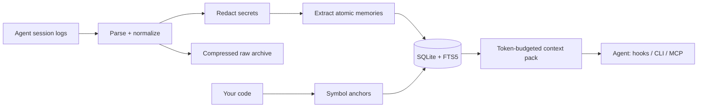

<div align="center">

# Recalla

**Memory your coding agents can trust.**

Local-first memory engine for Claude Code, Codex and other coding agents.
It turns your existing session history into compact, source-linked memories, flags a memory when the code it describes changes, and gives agents only what fits a token budget you set.

[](https://github.com/damndeepesh/recalla/actions/workflows/ci.yml)
[](LICENSE)


</div>

> [!WARNING]
> **Alpha (v0.1.0).** Imports Claude Code and Codex history and works end to end with Claude Code: backfill your history, install the hooks, and every new session starts with relevant memory. Extraction is rule-based, precise but not exhaustive, and still being tuned on real histories. See [ROADMAP.md](ROADMAP.md) for what's next, and please [open an issue](https://github.com/damndeepesh/recalla/issues) if it misses or invents something on your logs.

---

## Why Recalla

Coding agents forget everything between sessions, so you re-explain decisions and they repeat debugging they've already done. Memory tools exist, but they share four problems:

| Problem                                                                                                                               | What Recalla does                                                                                                                                      |
| ------------------------------------------------------------------------------------------------------------------------------------- | ------------------------------------------------------------------------------------------------------------------------------------------------------ |
| **History you already have is ignored.** Most tools only capture from install onward.                                                 | **Backfills** existing Claude Code and Codex sessions into atomic memories. Every memory links to the exact message it came from (`recalla why <id>`). |
| **Stale memories are served with full confidence.** A fact about code that has since changed looks as true as the day it was written. | **Anchors** memories to code symbols. When the symbol changes, the memory is marked `needs_reverify` instead of being silently trusted.                |
| **Memory eats the context window.** Large tool surfaces and LLM "observers" add thousands of tokens per request.                      | **Token budgets:** a 4-tool MCP surface (< 1k tokens), packs capped at the budget you set, and a ledger of exactly what was injected.                  |
| **Heavy runtimes and privacy risk.** Background daemons, vector databases and cloud extraction.                                       | **One binary, no daemon, no LLM, no network.** Secrets are redacted before anything touches disk.                                                      |

## How it works



- **Atomic memories:** decisions, facts, procedures, gotchas, preferences and tasks, each with provenance, confidence, scope (global, project or module) and a reversible lifecycle. Nothing is hard-deleted.
- **Deterministic identity:** a memory's ID is a hash of its content, so re-importing the same history never creates duplicates, and two machines agree on IDs without syncing.
- **Readable without the engine:** a markdown mirror (one file per memory) lets any agent or person read memory with no tooling.

See [ARCHITECTURE.md](ARCHITECTURE.md) for components and data flow.

## Status

| Component                                                           | State          |
| ------------------------------------------------------------------- | -------------- |
| Memory model + SQLite store (dedup, supersede/restore, BM25 search) | ✅ Done        |
| Layered secret redaction (known formats, keyword values, entropy)   | ✅ Done        |
| Claude Code + Codex session parsers                                 | 🚧 In progress |
| Resumable backfill + raw archive                                    | ⏳ Planned     |
| Rule-based memory extraction                                        | ⏳ Planned     |
| Code anchors + staleness                                            | ⏳ Planned     |
| Context packs + token ledger                                        | ⏳ Planned     |
| MCP server + agent hooks                                            | ⏳ Planned     |

The full plan is in [ROADMAP.md](ROADMAP.md), with current work in [TODO.md](TODO.md).

## Getting started

Recalla isn't released yet. To build from source:

```bash
git clone https://github.com/damndeepesh/recalla
cd recalla
make check   # format, lint, tests
make build   # target/release/recalla
```

Requires stable Rust (installed automatically via `rust-toolchain.toml` when using rustup).

**Usage:**

```bash
recalla backfill              # import Claude Code + Codex history and extract memories
recalla hooks install         # inject memory at session start, capture new turns (backs up settings.json)
claude mcp add --scope user recalla -- "$(command -v recalla)" mcp   # optional: recall/remember/review/why tools

recalla pack --budget 1500    # see the context pack for the current project
recalla search "rate limit"   # inspect memories
recalla why <id>              # where a memory came from
recalla stats                 # what was injected, and its token cost
recalla check                 # flag memories whose anchored code changed
recalla confirm <id>          # re-verify a flagged memory
recalla hooks uninstall       # remove only Recalla's hook entries

recalla mirror [--full]       # sync the markdown mirror now (it also updates after backfill, hooks and edits)
recalla rebuild --from-mirror # restore memories from the mirror; dry run first, --yes to apply (a backup is made)
```

### The markdown mirror

Every memory is also written as a plain markdown file under `<data dir>/mirror/` (default `~/.local/share/recalla/mirror/`), in `global/` and `projects/<project>/<kind>/<id>.md`. Each file has a small frontmatter (kind, scope, status, confidence, provenance, anchors) and the memory text. You or any agent can read it with `cat` and `grep`, no Recalla needed. Files are private (0600) and never deleted: archived and superseded memories keep theirs.

If the database is lost or damaged, `recalla rebuild --from-mirror` restores the memory layer from these files. Events and sources are kept. It is safe to run while Claude Code or `recalla mcp` are running: it takes a `VACUUM INTO` backup (`recalla.db.bak-<time>`) and then replaces the memory layer in one transaction, never swapping the database file.

It checks before touching anything and refuses the whole rebuild if any file is malformed, was edited (its id no longer matches its text), contains unredacted secrets, control or invisible characters, or has out-of-range values. The dry run shows how many memories are global, how many belong to each project, and which memories in the database are missing from the mirror; removing those needs `--yes --allow-drop`. Format: [ARCHITECTURE.md](ARCHITECTURE.md#mirror-mirror-recalla-mirrorrebuild).

## Privacy and security

- **Local only.** No network calls and no LLM calls in the default build. Your history never leaves your machine.
- **Redact before persist.** Secrets are scrubbed in three layers before any text is stored:
  1. Known credential formats
  2. Values of secret-bearing keys, headers and CLI flags
  3. An entropy catch-all for unknown formats

  The redactor is tested against a corpus of real-world credential shapes and fuzzed for crashes and idempotence.

- **Source logs are never modified.**

To report a vulnerability, see [SECURITY.md](SECURITY.md). Please don't open a public issue.

## Design principles

- **Trust over recall:** a stale or unverifiable memory is worse than none.
- **Measured, not claimed:** token cost and benchmark results are published, including losses.
- **Small surface:** few dependencies and few MCP tools. Every dependency is justified in [DESIGN_DECISIONS.md](DESIGN_DECISIONS.md).

## Contributing

Contributions are welcome. Start with [CONTRIBUTING.md](CONTRIBUTING.md). Issues labelled [`redaction`](https://github.com/damndeepesh/recalla/labels/redaction) are a good place to begin. All contributors are expected to follow the [Code of Conduct](CODE_OF_CONDUCT.md).

## License

Licensed under the [Apache License 2.0](LICENSE).
